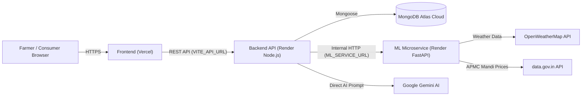

# 🚀 AgriSense Deployment Guide

This guide walks you through deploying the complete **AgriSense • AI Distress-Sale Timing Advisor** system to the cloud:
* **Frontend**: [Vercel](https://vercel.com) (React + Vite Single Page Application)
* **Backend API**: [Render](https://render.com) (Node.js + Express REST API)
* **Machine Learning Service**: [Render](https://render.com) (Python 3.11 + FastAPI + XGBoost)
* **Database**: [MongoDB Atlas](https://www.mongodb.com/atlas) (Managed Cloud MongoDB)

---

## 🏗️ Architecture & Communication Flow

---

## 📋 Pre-Deployment Checklist

Before deploying, ensure you have:
1. Your repository pushed to GitHub.
2. A free [Render account](https://render.com).
3. A free [Vercel account](https://vercel.com).
4. MongoDB Atlas cluster connection string:
   * **Important**: In MongoDB Atlas, go to **Network Access** → click **Add IP Address** → choose **Allow Access from Anywhere (`0.0.0.0/0`)** so Render cloud instances can connect.

---

## 🟢 Step 1: Deploy ML Microservice (Render)

Deploy this first so you obtain its public URL (needed by the Node.js backend).

1. Log in to [dashboard.render.com](https://dashboard.render.com).
2. Click **New +** → **Web Service**.
3. Select your GitHub repository (`mini-project`).
4. Configure the settings:
   * **Name**: `agrisense-ml-service`
   * **Region**: `Singapore` (or closest to India)
   * **Root Directory**: `ml_service`
   * **Runtime**: `Python 3`
   * **Build Command**: `pip install -r requirements.txt`
   * **Start Command**: `uvicorn app.main:app --host 0.0.0.0 --port $PORT`
   * **Instance Type**: `Free`
5. Click **Advanced** and add the following **Environment Variables**:

| Variable Key | Value | Note |
|---|---|---|
| `PYTHON_VERSION` | `3.11.9` | Ensures Python 3.11 runtime |
| `MONGO_URI` | `mongodb+srv://<username>:<password>@cluster.mongodb.net/agrisense?retryWrites=true&w=majority` | Your MongoDB connection string |
| `OPENWEATHER_API_KEY` | `your_openweathermap_api_key_here` | Weather forecasting |
| `DATA_GOV_IN_API_KEY` | `your_data_gov_in_api_key_here` | APMC price sync |
| `DATA_GOV_IN_RESOURCE_ID` | `35985678-0d79-46b4-9ed6-6f13308a1d24` | Mandi resource ID |

6. Click **Create Web Service**.
7. Once deployed, note down the service URL:
   * Example: `https://agrisense-ml-service.onrender.com`
   * Test health endpoint: `https://agrisense-ml-service.onrender.com/health` (should return status `healthy`/`ok`).

---

## 🟣 Step 2: Deploy Backend API (Render)

1. In Render dashboard, click **New +** → **Web Service**.
2. Select the same GitHub repository (`mini-project`).
3. Configure the settings:
   * **Name**: `agrisense-backend`
   * **Region**: Same region as ML service (e.g. `Singapore`)
   * **Root Directory**: `backend`
   * **Runtime**: `Node`
   * **Build Command**: `npm install`
   * **Start Command**: `npm start`
   * **Instance Type**: `Free`
4. Click **Advanced** and add the following **Environment Variables**:

| Variable Key | Value | Description |
|---|---|---|
| `NODE_ENV` | `production` | Production mode |
| `PORT` | `10000` | Port listened by Express |
| `MONGO_URI` | `mongodb+srv://<username>:<password>@cluster.mongodb.net/agrisense?retryWrites=true&w=majority` | MongoDB connection string |
| `JWT_SECRET` | `your_jwt_secret_key_here` | Secret for farmer authentication tokens |
| `ML_SERVICE_URL` | `https://agrisense-ml-service.onrender.com` | **URL of the ML service from Step 1** |
| `GEMINI_API_KEY` | `your_gemini_api_key_here` | Google Gemini API key for AI Assistant |
| `OPENWEATHER_API_KEY` | `your_openweathermap_api_key_here` | OpenWeatherMap API |
| `DATA_GOV_IN_API_KEY` | `your_data_gov_in_api_key_here` | Daily APMC price sync |
| `CLIENT_ORIGIN` | `https://your-frontend.vercel.app` | (Optional - CORS is already configured to automatically allow all `*.vercel.app` domains) |

5. Click **Create Web Service**.
6. Once deployed, note down the backend URL:
   * Example: `https://agrisense-backend.onrender.com`
   * Test health check: `https://agrisense-backend.onrender.com/api/health`

---

## ⚡ Step 3: Deploy Frontend (Vercel)

1. Log in to [vercel.com](https://vercel.com) and click **Add New...** → **Project**.
2. Choose your GitHub repository (`mini-project`) and click **Import**.
3. In the project setup screen:
   * **Framework Preset**: `Vite` (Vercel detects this automatically)
   * **Root Directory**: Click *Edit* and select `client`
   * **Build Command**: `npm run build`
   * **Output Directory**: `dist`
4. Expand **Environment Variables** and add:

| Name | Value |
|---|---|
| `VITE_API_URL` | `https://agrisense-backend.onrender.com` *(Your Render Backend URL from Step 2)* |
| `VITE_GEMINI_API_KEY` | `your_gemini_api_key_here` |

5. Click **Deploy**.
6. Vercel will build and deploy the frontend in under 1 minute.
   * You will receive your live domain, e.g. `https://agrisense-client.vercel.app`.

---

## ⚡ Alternative: 1-Click Render Blueprint

The repository includes a ready-to-use [`render.yaml`](file:///c:/Users/subra/mini_project/mini-project/render.yaml) file.
1. On Render, click **New +** → **Blueprint**.
2. Select your repository.
3. Render will automatically read `render.yaml` and configure both `agrisense-backend` and `agrisense-ml-service` together, linking `ML_SERVICE_URL` automatically!

---

## 💡 Important Production Tips (Render Free Tier)

1. **Cold Starts**:
   * Render Free tier instances spin down after 15 minutes of inactivity.
   * If asleep, the first request takes ~30–40 seconds to wake up.
   * **Solution**: You can use a free monitoring service like [UptimeRobot](https://uptimerobot.com) or [cron-job.org](https://cron-job.org) to ping `https://your-backend.onrender.com/api/health` every 10 minutes to keep it warm 24/7.
2. **CORS Configuration**:
   * `backend/app.js` has been pre-configured with a wildcard rule allowing all `*.vercel.app` and `*.onrender.com` domains. You do not need to manually edit CORS headers for preview branches!
3. **Single Page Application (SPA) Routing**:
   * `client/vercel.json` has been included with rewrite rules so direct page reloads will never return 404 errors on Vercel.

---

## 🧪 Post-Deployment Verification Steps

Once all 3 services are live:
1. Open your Vercel URL: `https://your-app.vercel.app`
2. Check the green badge on the top navbar: **सिस्टीम: ऑनलाइन (System: Online)**.
3. Test a Timing Decision: Select **Tomato**, **Kolhapur APMC**, and click **सल्ला मिळवा (Get Advisory)**.
4. Test the AI Assistant Chatbot:
   * Click the green floating button at bottom-right.
   * Ask: `"टोमॅटो भाव"` → Live Market Price Card should appear.
   * Click **"ऐका" (Listen)** → Audio agent speaks out the mandi prices.
